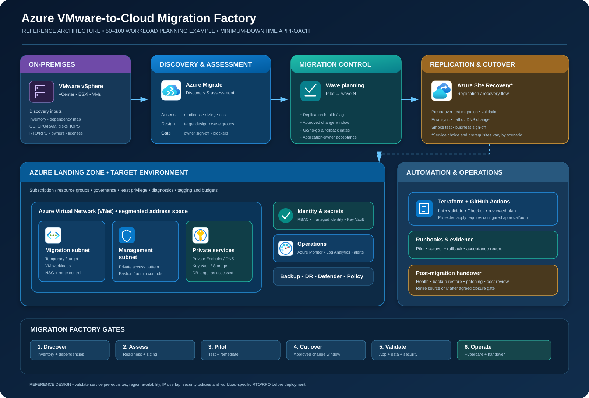
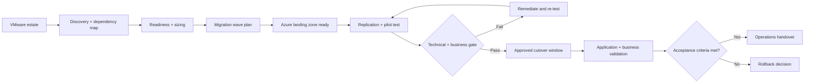

<div align="center">


### Discover · Assess · Wave-plan · Migrate · Validate · Operate

[](https://azure.microsoft.com/)
[](https://developer.hashicorp.com/terraform)
[](https://docs.github.com/actions)
[](https://learn.microsoft.com/azure/migrate/)

**A migration-factory blueprint for planning VMware-to-Azure workload moves with dependency-aware waves, landing-zone readiness, controlled cutover and explicit rollback gates.**

[Target architecture](#-target-architecture) · [Migration lifecycle](#-migration-lifecycle) · [Terraform foundation](#-terraform-foundation) · [Runbooks](runbooks/README.md)

</div>

> [!IMPORTANT]
> This is a planning and engineering reference. It does **not** claim that 50–100 real servers have been migrated, that Azure Migrate appliances are configured, or that a production cutover has occurred. Downtime depends on workload consistency, replication, network throughput and the selected migration method.

## Executive brief

Large-scale migration is not a VM-copy exercise. The factory model coordinates discovery, dependency mapping, landing-zone readiness, wave planning, pilot testing, business acceptance and operational handover.

The planning example considers an estate of 50–100 VMware workloads. Actual wave size must be based on application dependencies, criticality, RTO/RPO, capacity and change windows — not a fixed server count.

## Target architecture

<p align="center">
  
</p>

The diagram is a target/reference design and embeds Azure service icons. For editable architecture, use the source files in `architecture/` and Microsoft's [Azure Architecture Icons guidance](https://learn.microsoft.com/azure/architecture/icons/).

## Migration lifecycle



## Factory workstreams

| Workstream | Key outputs |
|---|---|
| Discovery | VM inventory, owner, OS, dependencies, utilization |
| Assessment | Readiness, sizing, licensing, risk and blockers |
| Landing zone | Network, identity, security, DNS, monitoring, backup |
| Wave planning | Dependency groups, schedule, owners, go/no-go criteria |
| Pilot | Representative test migration and measured validation |
| Cutover | Change plan, communications, acceptance and rollback |
| Operations | Monitoring, patching, backup, DR, ownership and cost controls |

## Migration planning assumptions

- **Source:** VMware vSphere; actual inventory and dependencies must be discovered.
- **Target:** Azure landing zone with approved connectivity and security controls.
- **Scale:** 50–100 workloads is a planning scenario, not a measured estate.
- **Downtime:** minimize planned downtime; do not promise zero downtime without workload-specific proof.
- **Tooling:** Azure Migrate and Azure Site Recovery require service configuration, appliances/agents, permissions, capacity checks and workload-specific runbooks.
- **Terraform:** provisions selected foundation resources; it does not perform a complete VM migration.

## Terraform foundation

Prerequisites: Terraform CLI, Azure CLI, a non-production subscription and permissions to create the configured network resources.

From the repository's `terraform/` directory:

```bash
az login
az account show
az account set --subscription "<SUBSCRIPTION_ID>"
cd environments/dev
cp terraform.tfvars.example terraform.tfvars
terraform init
terraform fmt -check -recursive
terraform validate
terraform plan
```

Review the complete plan and estimated cost before applying. Confirm the target subscription and region. Never commit credentials, state, plan files, private keys or sensitive inventory.

## Go / no-go criteria

Before a migration wave proceeds, confirm:

- Application owner and technical owner are identified.
- Dependencies, ports, DNS and identity flows are documented.
- Target subnet, security policy, monitoring and backup are ready.
- Replication health and recovery objectives are understood.
- Pilot test evidence meets agreed acceptance criteria.
- Business communications and change approval are complete.
- Rollback decision owner, trigger and execution path are explicit.

## Repository map

| Directory | Purpose |
|---|---|
| `architecture/` | Target architecture SVG and editable source |
| `terraform/` | Azure foundation Terraform scaffold |
| `migration-planning/` | Discovery, waves, cutover gates and templates |
| `runbooks/` | Pilot, cutover, rollback procedures |
| `docs/` | Assumptions, RACI, decisions and engineering notes |
| `interview-prep/` | Senior migration scenarios and answers |
| `.github/workflows/` | Terraform validation and IaC scanning |

## Operational and security principles

- Use least-privilege identities and OIDC for automation where configured.
- Keep credentials and sensitive discovery exports out of Git.
- Secure remote state and restrict deployment permissions.
- Test backup and rollback rather than relying on documentation alone.
- Validate application behavior, not only VM power state.
- Track cost, licensing, capacity and data residency.
- Treat migration completion as an application-owner acceptance decision.

## Further reading

- [Migration planning templates](migration-planning/README.md)
- [Execution runbooks](runbooks/README.md)
- [Architecture and interview guide](docs/README.md)
- [Zero-to-hero guide](docs/ZERO-TO-HERO.md)
- [Advanced interview bank](docs/ADVANCED-INTERVIEW-BANK.md)

## Maintainer

**MD Amirul Haque** · [GitHub](https://github.com/haqueamir70-coder) · [LinkedIn](https://www.linkedin.com/in/md-amirul-haque/)

<sub>Plan by dependency. Cut over by evidence. Recover by design.</sub>
