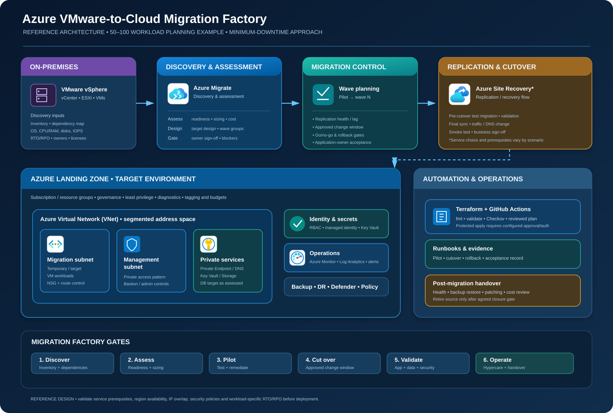
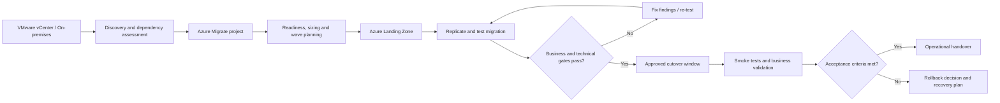

<div align="center">


<p><b>Enterprise migration planning • Azure landing zone • Terraform • Security • Cutover and rollback</b></p>

[](https://azure.microsoft.com/)
[](https://developer.hashicorp.com/terraform)
[](https://docs.github.com/actions)
[](https://github.com/haqueamir70-coder)

</div>

> **Portfolio and learning lab.** This repository contains a reference migration method, Terraform starter infrastructure, decision records, operating runbooks, and testable automation. It does not claim that a live VMware estate has been migrated or that a production cutover has occurred.

## Executive summary

A migration-factory blueprint for planning the move of **50–100 VMware workloads to Microsoft Azure with minimum planned downtime**. It demonstrates the engineering workflow from discovery and dependency mapping through landing-zone readiness, pilot migration, migration waves, controlled cutover, rollback decisions, and post-migration operations.

## Architecture overview



The SVG and editable draw.io source use clearly labeled, Azure-style service tiles. For official product icons, use the [Microsoft Azure Architecture Icons](https://learn.microsoft.com/en-us/azure/architecture/icons/) collection and follow Microsoft's terms and guidance. The diagram represents the **target/reference design**, not deployed resources.

### Migration flow



## What is in this repository?

| Area | Contents |
|---|---|
| `architecture/` | Azure service-icon diagram and editable source |
| `terraform/` | Minimal baseline networking scaffold, environment example, validation workflow |
| `migration-planning/` | Discovery, wave planning, cutover gates, rollback and validation templates |
| `runbooks/` | Pilot execution, cutover and rollback procedures |
| `docs/` | Reference design, assumptions, RACI and decision records |
| `interview-prep/` | Senior-level questions, architecture trade-offs and scenario answers |
| `.github/workflows/` | Terraform format/validate and static IaC scanning |

## Target scope and assumptions

- **Source:** VMware vSphere estate; inventory, application ownership, dependencies and licensing must be discovered.
- **Target:** Azure landing zone with segmented virtual networks and controlled connectivity.
- **Scale:** planning example for 50–100 servers; actual wave size is determined by dependency, business criticality, RTO/RPO and capacity.
- **Downtime:** minimize downtime, not promise zero downtime. Replication and final outage depend on workload, application consistency, data-change rate, network throughput and chosen migration method.
- **Infrastructure as Code:** Terraform scaffold for selected Azure foundation resources. Azure Migrate and Azure Site Recovery workflows require separate service configuration, permissions, appliances/agents, capacity checks and operational approvals; the Terraform files do not perform an end-to-end migration by themselves.
- **Cost:** no resources are deployed by the repository merely by cloning it. Review pricing, quotas, region support and the plan before applying.

## Quick start — Terraform foundation

Requirements: Terraform CLI, Azure CLI, an Azure subscription, and permissions to create a resource group, virtual network and subnets.

```bash
az login
az account show
cd terraform/environments/dev
cp environments/dev/terraform.tfvars.example terraform.tfvars
terraform init
terraform fmt -check -recursive
terraform validate
terraform plan
```

Run these commands from the `terraform/` directory. Set the intended subscription explicitly with `az account set --subscription "<SUBSCRIPTION_ID>"`. Review the complete plan before running `terraform apply`. The scaffold creates cloud resources and can incur charges; do not apply to production without review.

## Suggested project walkthrough

1. Build a discovery inventory and assess application dependencies.
2. Define landing-zone connectivity, identity, policy, monitoring, DNS and security requirements.
3. Group servers into waves by dependency and business risk — not just by VM count.
4. Rehearse a representative pilot in a non-production environment.
5. Use documented go/no-go gates, stakeholder approval, validation evidence and explicit rollback decision points.
6. Hand over monitoring, backup, patching, DR, ownership and cost controls.

Detailed planning and acceptance templates are under [migration-planning](migration-planning/README.md); practical procedures are under [runbooks](runbooks/README.md).

## Security principles

- Use short-lived authentication/OIDC for CI when configured; avoid long-lived client secrets.
- Keep credentials, SSH private keys, exported inventories containing sensitive values, state files and secret-bearing plans out of Git.
- Restrict Terraform state backend and deployment identity using least privilege.
- Treat the diagrams and sample values as illustrative. Confirm region availability, service prerequisites, and organizational policy before deployment.
- Pin and review action versions and provider constraints before production use.

## Validation status

GitHub Actions is intended to run formatting, initialization/validation and a static IaC scan against the starter Terraform. Green CI does **not** prove that a workload can be migrated, that a target environment meets an application’s RTO/RPO, or that a production migration has occurred. No actual migration is claimed by this repository.

## Disclaimer

This is an engineering learning and portfolio project, not Microsoft product documentation or a substitute for workload-specific assessment, Microsoft service prerequisites, change-management approval, or a tested recovery plan.
