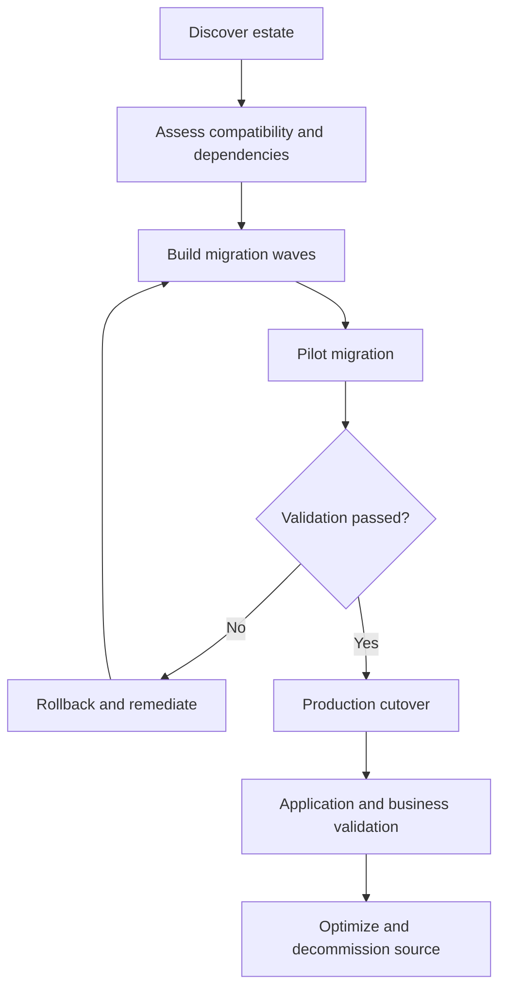

# Azure VMware migration factory — Architecture & Interview Guide

Migration operating model covering discovery, dependency mapping, wave planning, pilot, cutover and rollback. This repository is a planning and automation reference, not evidence of completed customer migrations.

## Architecture diagram

## Interview questions

1. 1. What are the phases of an Azure VMware migration?
2. 2. How do you discover application dependencies?
3. 3. What criteria define a migration wave?
4. 4. How do you select pilot workloads?
5. 5. What is the difference between test migration and production migration?
6. 6. How do you define RTO and RPO for migration planning?
7. 7. What are common cutover failure modes?
8. 8. How do you design a rollback decision and runbook?
9. 9. How do you validate network, DNS, identity and application dependencies after cutover?
10. 10. What evidence is required before decommissioning source infrastructure?

## Interview preparation note
Answer with architecture rationale, security controls, operational failure scenarios, observability and test evidence. Clearly label implemented, CI-validated, deployed and planned scope.

## Interview questions — suggested answers

### 1. Answer

Typical phases are discovery, assessment, design, pilot, migration waves, cutover, optimization and decommissioning. Each phase has entry/exit criteria.

### 2. Answer

Use inventory tools, dependency maps, network flows, application owner interviews and performance data. Validate dependencies with application owners before wave assignment.

### 3. Answer

Group workloads by dependency, business criticality, maintenance window, technical compatibility, network boundaries and rollback complexity.

### 4. Answer

Choose representative but low-risk workloads with clear owners, measurable success criteria and rollback paths. A pilot validates process and tooling.

### 5. Answer

Test migration validates replication and readiness without final production cutover; production migration switches workload operation and user traffic.

### 6. Answer

RTO is the maximum acceptable recovery time; RPO is the maximum acceptable data-loss window. Set both with business owners and test them.

### 7. Answer

Common failures include DNS/routing errors, identity issues, storage performance, dependency omissions, replication lag and application licensing/configuration.

### 8. Answer

Define preconditions, go/no-go gates, decision authority, rollback triggers, exact steps, data consistency handling and communications before cutover.

### 9. Answer

Test DNS, routes, firewall, identity, storage, application health, integrations, performance and business transactions from representative locations.

### 10. Answer

Require owner sign-off, stable operation, backup/restore validation, monitoring, compliance approval and confirmed data retention before decommissioning source.

## Complete zero-to-hero guide

See [ZERO-TO-HERO.md](./ZERO-TO-HERO.md) for the business scenario, architecture walkthrough, tool-by-tool explanations, implementation sequence, practical commands, troubleshooting playbook and additional scenario-based interview questions with answers.
