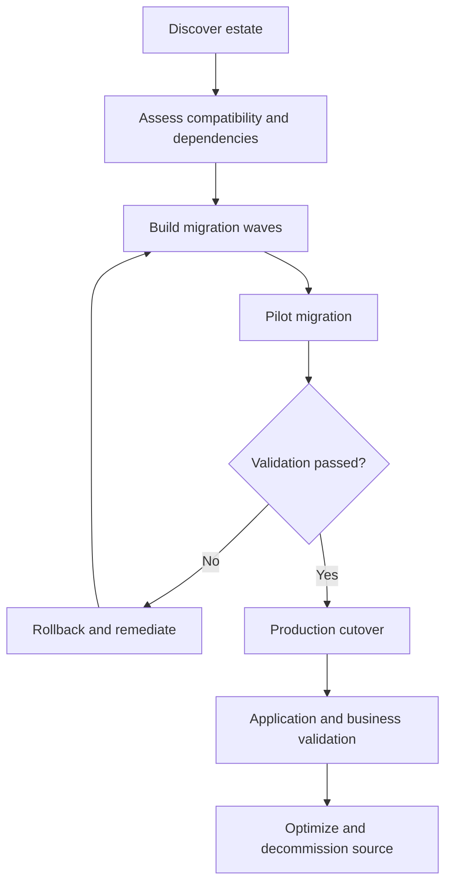

# Azure VMware migration factory — Architecture & Interview Guide

Migration operating model covering discovery, dependency mapping, wave planning, pilot, cutover and rollback. This repository is a planning and automation reference, not evidence of completed customer migrations.

## Architecture diagram

## Interview questions

1. 1. What are the phases of an Azure VMware migration?
2. 2. How do you discover application dependencies?
3. 3. What criteria define a migration wave?
4. 4. How do you select pilot workloads?
5. 5. What is the difference between test migration and production migration?
6. 6. How do you define RTO and RPO for migration planning?
7. 7. What are common cutover failure modes?
8. 8. How do you design a rollback decision and runbook?
9. 9. How do you validate network, DNS, identity and application dependencies after cutover?
10. 10. What evidence is required before decommissioning source infrastructure?

## Interview preparation note
Answer with architecture rationale, security controls, operational failure scenarios, observability and test evidence. Clearly label implemented, CI-validated, deployed and planned scope.
